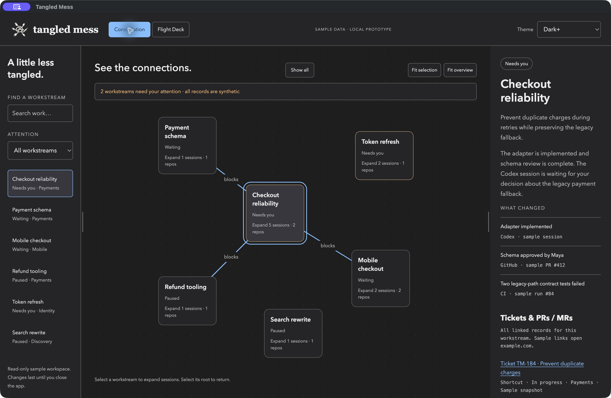

<p align="center">
  
</p>

# Tangled Mess

### More work in flight. Less context in your head.

Your coding agents can work across several tickets, branches, and repositories at once. Remembering what each one is doing—and what needs you next—still falls on you.

Tangled Mess is a desktop companion that brings those moving pieces into one visual workspace. See the objective behind each session, follow the blockers, and pick up where you left off with a concise context brief. Keep coding in the tools you already use.



*The current Electron prototype running on macOS, with synthetic workstreams and sessions.*

## Untangle your work

- **See the whole picture.** Constellation maps workstreams and their dependencies. Expand an objective to reveal its agent sessions across repositories.
- **Know what needs you.** Attention states and pulsing borders highlight work waiting for your input.
- **Return with context.** Switch Briefs show the objective, recent changes, and a suggested next move.
- **Keep the sources close.** Tickets, pull requests, and merge requests sit alongside session details and source links.
- **Choose your view.** Switch to Flight Deck for a session-rich list, resize the sidebars, and choose an IDE-inspired theme—or Retrowave.

Tangled Mess supports the way you work across coding harnesses. Editing code, prompting agents, reviewing changes, and merging stay in their original tools.

## Where it stands

This is a macOS Electron prototype with real local session import and optional AI guidance. It also includes six synthetic workstreams for exploring the UI. Sample source links open example.com. Attention-state edits remain in memory; theme, sidebar widths, configuration, and imported snapshots are saved locally.

Local import supports Codex and Cursor transcripts and OpenCode session metadata. A Claude transcript reader is available but has not been validated on the development machine. Import is bounded to the 50 newest sessions per source, with bounded recent user and assistant excerpts for transcript sources. Folder-based workstreams are provisional: they do not establish shared objectives, live status, or dependencies. GitHub/GitLab, ticket gathering, and harness MCP reuse are **not implemented yet**.

Application records are stored locally in Electron's user-data directory; supplied keys are encrypted using Electron safeStorage. Generating guidance sends selected imported context to your chosen engine: Cursor CLI, OpenAI, or Anthropic. API use may incur charges and provider retention policies apply. Local import itself does not call AI. API keys do not inherit another application's MCP connections.

## Install and run on macOS

You need Git, Node.js 22 or later, and npm. There is no packaged installer yet; run the app from source:

```sh
git clone https://github.com/chrislaughlin/tangled-mess.git
cd tangled-mess
npm ci
npm start
```

The first install downloads Electron. OpenCode import also uses macOS's `/usr/bin/sqlite3` in read-only mode.

### First-run setup

1. Choose any combination of Codex, Cursor, OpenCode, and Claude as session sources. The app reads existing local histories; it does not need those CLIs just to import files.
2. Choose a processing engine independently of your session sources. **None** lets you import without AI. **OpenAI** and **Anthropic** require a provider API key and a model ID available to that account. **Cursor CLI** can use your existing Cursor sign-in or an optional Cursor API key; leave its model blank to use Cursor's default.
3. Select **Validate sources & import local sessions**. Inspect the source report if a history is missing or unreadable.
4. Generate guidance for the selected workstream, or across all imported workstreams. The overview includes up to 200 sessions regardless of filters and labels partial coverage. Suggested relationships are not automatically added to the map.

Use **Settings** in the header or **⌘,** to return to configuration. **Check installed tools** reports CLI availability and Cursor sign-in status.

### Optional: prepare Cursor processing

Install the official Cursor CLI, then sign in:

```sh
curl https://cursor.com/install -fsS | bash
~/.local/bin/agent login
~/.local/bin/agent status
```

Select **Cursor CLI** in Settings. It can summarize Codex and OpenCode sessions as well as Cursor sessions. Generation uses Ask mode with sandboxing in a temporary workspace; it does not enable MCP ticket collection. See [Cursor's CLI documentation](https://cursor.com/docs/cli/headless).

### Update an existing checkout

```sh
git pull
npm ci
npm start
```

Quit the existing Electron app before restarting after an update. **⌘R** reloads the interface, but backend and preload changes require a complete restart.

### Browser preview

For a browser preview, run `npm run preview` and open http://localhost:4174/desktop/.

The browser supports sample data only. Local session import, encrypted credential storage, and AI generation require Electron.

Try selecting **Checkout reliability**, expanding its sessions, and returning to the overview from its root. Use **Fit selection** and **Fit overview** to frame the map, or switch to **Flight Deck** to compare sessions. Resume records a provisional focus checkpoint without opening a real coding session.

Plans: [product](PRODUCT_PLAN.md), [design](DESIGN_PLAN.md), [glossary](CONTEXT.md).
